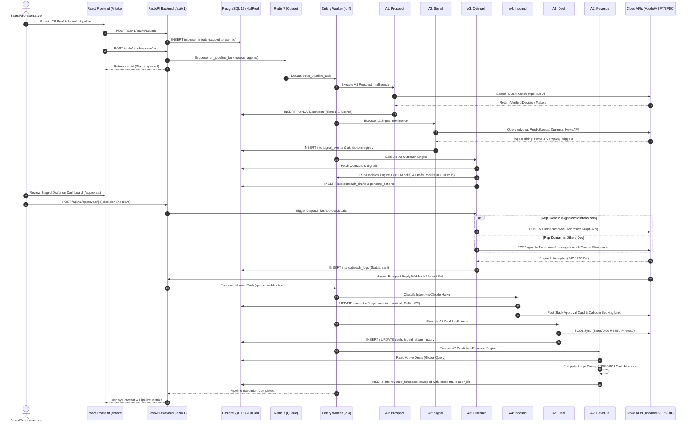

# GTM Platform — Business, Functional and Technical Documentation

**Target Repository:** `gtm-platform`  
**Active Branch:** `shree-dev`  
**Document Classification:** Formal Technical & Functional Specification  
**Audit & Reconciliation Date:** October 2026  
**Auditor:** Antigravity Advanced Agentic System (Audit-Only; Zero-Mutation)

---

## 1. Executive Summary

### 1.1 Platform Purpose and Vision
The **GTM 7-Agent Engine** is an enterprise-grade Go-To-Market (GTM) intelligence and execution platform. It automates the end-to-end B2B revenue pipeline—from Ideal Customer Profile (ICP) definition and prospect discovery to signal-grounded multi-channel outreach, inbound conversation intelligence, CRM opportunity management, marketing collateral generation, and predictive 30/60/90-day cash flow forecasting.

The platform eliminates the operational fragmentation inherent in traditional sales development by replacing disconnected point solutions with seven coordinated, autonomous AI agents operating on top of a centralized asynchronous backend (FastAPI, PostgreSQL 16 with pgvector, Redis, and Celery) paired with a modern React 18 Single Page Application (SPA).

### 1.2 Core Capabilities and Operational Scope
1. **Target Account Discovery & Win-Pattern Scoring (Agent 1):** Ingests ICP briefs, queries live data providers (Apollo.io) with offline fallback data, applies a 100-point win-pattern algorithm, and segments prospects into Tier 1, Tier 2, and Tier 3 cohorts.
2. **Real-Time Market Signal Intelligence (Agent 2):** Scrapes and synthesizes hiring surges (Adzuna), corporate milestones (PredictLeads), news headlines (Currents API, NewsAPI, Google News RSS), community pain points (Apify Reddit Scraper), and website technology stack fingerprints.
3. **Hyper-Personalized Multi-Channel Outreach (Agent 3):** Generates 3-touch personalized sequences (Email, LinkedIn, Phone) and coordinates multi-provider dispatch with enterprise domain enforcement (Microsoft Graph API for `@forcecloudlabs.com` sales representatives, Google Workspace / Gmail API, Instantly, SMTP, and Resend).
4. **Autonomous Inbound Conversation Intelligence (Agent 4):** Ingests prospect replies, performs 7-class intent classification via Claude Haiku, recalculates deal readiness scores, stages Cal.com meeting booking links, and posts interactive approval alerts to Slack and Ntfy.
5. **CRM Opportunity Sync & Call Intelligence (Agent 5):** Bidirectionally synchronizes Opportunities with Salesforce CRM (REST API v60.0), parses sales meeting transcripts from Fireflies.ai for BANT qualification, scores deal health (0–100), and flags deal stalling risks.
6. **Pipeline Content Generation (Agent 6):** Synthesizes upstream objections, win patterns, and market signals into marketing collateral across 5 formats (LinkedIn posts, cold email snippets, case studies, battlecards, and whitepaper outlines) with hash-seeded vector indexing in PostgreSQL via pgvector.
7. **Predictive Cash Flow & Bottleneck Forecasting (Agent 7):** Models exponential time-in-stage decay on active opportunities, projects expected cash flow across 30, 60, and 90-day horizons, and diagnoses conversion bottlenecks across pipeline stages.

### 1.3 Key Technical Findings & Critical Distinctions
- **Multi-Tenant / Multi-Sales-Rep Isolation Status:** Implemented at the database layer across `user_inputs`, `contacts`, `outreach_drafts`, `workflow_runs`, and `user_integrations`. Inbound mail polling and outreach dispatching are strictly scoped to authenticated rep identities. **Critical Exception:** In the current codebase ([backend/app/agents/a7_revenue.py:162-171](file:///c:/Users/shree/Downloads/gtm-platform/backend/app/agents/a7_revenue.py#L162-L171)), Agent 7 operates as a company-wide aggregator without user-level deal isolation; it queries all active deals globally and stamps forecasts with the owner of the latest global intake brief ([a7_revenue.py:79-93](file:///c:/Users/shree/Downloads/gtm-platform/backend/app/agents/a7_revenue.py#L79-L93)).
- **Synthetic Fallback Data Disclosure:** While Agent 5 eliminated synthetic deal values, Agent 7 retains an uncalibrated **$25,000 default deal amount fallback** ([a7_revenue.py:280-284](file:///c:/Users/shree/Downloads/gtm-platform/backend/app/agents/a7_revenue.py#L280-L284)) whenever CRM deal amounts are null or zero, as well as in top-of-funnel inflow projections ([a7_revenue.py:466](file:///c:/Users/shree/Downloads/gtm-platform/backend/app/agents/a7_revenue.py#L466)).
- **DeepSeek Exclusion (Audit Finding):** DeepSeek is **not** an active provider and is **not** utilized in production. While dormant OpenAI-compatible caller code exists in [backend/app/services/llm_service.py](file:///c:/Users/shree/Downloads/gtm-platform/backend/app/services/llm_service.py#L34) and [backend/app/core/config.py](file:///c:/Users/shree/Downloads/gtm-platform/backend/app/core/config.py#L138), no API key is provisioned, and it is excluded from the active fallback chain and purchasing roadmap.
- **CRM Migration Truth:** HubSpot CRM has been **deprecated** ([backend/app/services/__init__.py](file:///c:/Users/shree/Downloads/gtm-platform/backend/app/services/__init__.py#L300-L315)), raising runtime warnings and returning empty stubs. **Salesforce CRM** is the sole active CRM integration in the platform.
- **Embedding Architecture Trade-Off:** To reduce Docker image size from ~4.0 GB to under 600 MB on Render, PyTorch and `sentence-transformers` were removed. `EmbeddingService` generates deterministic 384-dimensional vectors using MD5 hash seeding. While functional for PostgreSQL pgvector schema compatibility, it does not provide semantic vector search.

---

## 2. Business Problem & Platform Objectives

### 2.1 The Business Problem
B2B Go-To-Market organizations face compounding inefficiencies:
- **Disparate Tool Silos:** Sales development representatives (SDRs) toggle between Apollo for contact data, LinkedIn for signals, Google/Outlook for manual emailing, HubSpot/Salesforce for CRM logging, and Gong/Fireflies for call review.
- **Low Outreach Relevance:** Generic cold email campaigns yield sub-1% reply rates because SDRs lack the time to research genuine company signals (hiring surges, funding, executive turnover).
- **Delayed Inbound Qualification:** Prospect responses often sit in rep inboxes for hours or days, causing high drop-off before meetings can be scheduled.
- **Inaccurate Forecasting:** Sales leadership relies on subjective rep self-reporting and nominal CRM stages rather than quantitative time-in-stage velocity and verified qualification criteria.

### 2.2 Core Platform Objectives
| Strategic Objective | Measurable Platform Target | Supporting Agent / Subsystem |
| :--- | :--- | :--- |
| **Pipeline Acceleration** | Reduce time spent on prospecting and sequence generation by 80% | Agent 1 (Prospect) & Agent 3 (Outreach) |
| **Outreach Relevance** | Ground 100% of outbound messages in verified market and company signals | Agent 2 (Signal Intelligence) |
| **Inbound Speed to Lead** | Ingest, classify, and stage personalized responses to inbound replies within 60 seconds | Agent 4 (Conversation Intelligence) & Celery Beat |
| **CRM Data Hygiene** | Eliminate manual CRM logging by auto-syncing opportunities and logging call tasks | Agent 5 (Deal Intelligence & Salesforce v60.0) |
| **Objective Forecasting** | Project 30/60/90-day cash flow using mathematical stage decay rather than subjective rep claims | Agent 7 (Predictive Revenue Engine) |

---

## 3. Functional Scope

### 3.1 In-Scope Features (Implemented in Codebase)
- **Account & Persona Ingestion:** Frontend form (`/intake`) capturing target titles, locations, industries, company size ranges, offering value propositions, and scoring thresholds.
- **Algorithmic Lead Scoring:** Deterministic 100-point win-pattern evaluation factoring seniority, industry match, headcount sweet-spot, and contact data completeness.
- **Multi-Source Signal Harvesting:** Automated gathering of job growth signals, corporate milestone events, RSS news articles, Reddit discussions, and website tech stack fingerprints.
- **Adaptive Multi-Provider Outbound Dispatch:** Domain-enforced email delivery prioritizing Microsoft Graph API for company reps, Google Workspace OAuth for personal reps, Instantly, SMTP, and Resend.
- **7-Class Intent Classification & Delta Scoring:** Machine learning classification of buyer intent with automated pipeline readiness score adjustments.
- **Human-in-the-Loop Approval Queues:** Staged outreach reviews via the React frontend and interactive Slack/Ntfy notification cards with 2-hour timeout expiration gates.
- **Salesforce CRM Integration:** Bidirectional opportunity querying and automated task/note creation via Salesforce REST API v60.0.
- **Upstream Content Syndication:** Synthesis of pipeline objections into LinkedIn posts, email follow-ups, case studies, battlecards, and blog outlines.
- **Predictive Horizon Cash Allocation:** Automated discounting of pipeline value across 30, 60, and 90-day horizons based on time-in-stage decay.

### 3.2 Out-of-Scope & Excluded Capabilities
- Direct programmatic telephone dialing (Agent 3 generates phone call scripts, but does not initiate telephony calls).
- Direct LinkedIn automated direct-messaging (Agent 3 drafts LinkedIn InMail snippets for rep copy-pasting; direct LinkedIn API automation is excluded to protect user LinkedIn profiles from ban risks).
- Self-hosted LLM model training (the platform consumes cloud LLM APIs via REST; it does not perform local model training).
- DeepSeek API execution (dormant in code; excluded from operational use).
- HubSpot CRM active synchronization (HubSpot is retired and non-operational).

---

## 4. System Architecture

### 4.1 System Topology
The platform implements a decoupled, asynchronous microservices architecture:
1. **Frontend Presentation Tier:** React 18 SPA hosted on Netlify, utilizing TanStack Query for state management, Axios for authenticated API interaction, and TailwindCSS for responsive styling.
2. **API & Orchestration Tier:** FastAPI web application hosted on Render, exposing versioned REST endpoints, enforcing JWT security, validating request schemas via Pydantic, and managing Celery task enqueuing.
3. **Distributed Worker Tier:** Celery workers backed by Redis 7, processing background tasks across dedicated queues (`default`, `agents`, `webhooks`) with a concurrent Celery Beat scheduler executing periodic cron jobs.
4. **Data Persistence Tier:** Managed PostgreSQL 16 on Render, utilizing the `pgvector` extension for 384-dimensional vector embeddings, normalized across 22 relational models managed by 19 Alembic migrations.

### 4.2 Mermaid System Architecture Diagram

```mermaid
graph TB
    subgraph Client_Tier ["Client Tier (Netlify)"]
        SPA["React 18 SPA (Vite + TailwindCSS)"]
        AuthCtx["Auth Context (JWT Access & Refresh)"]
        SessCtx["Active Session Context (Multi-User)"]
        SPA --> AuthCtx
        SPA --> SessCtx
    end

    subgraph API_Gateway ["Backend Application (Render Web Service)"]
        FastAPI["FastAPI Engine (app/main.py)"]
        Security["JWT & Role Enforcement (get_current_user)"]
        Fernet["Token Encryption (APP_SECRET_KEY)"]
        
        RouterAuth["/api/v1/auth"]
        RouterOrch["/api/v1/orchestrator"]
        RouterAgents["/api/v1/agents"]
        RouterPipeline["/api/v1/deals"]
        RouterIntegrations["/api/v1/integrations"]
        RouterAdmin["/api/v1/admin"]

        FastAPI --> Security
        FastAPI --> Fernet
        FastAPI --> RouterAuth
        FastAPI --> RouterOrch
        FastAPI --> RouterAgents
        FastAPI --> RouterPipeline
        FastAPI --> RouterIntegrations
        FastAPI --> RouterAdmin
    end

    subgraph Persistence ["Persistence & Cache Tier (Render Managed)"]
        PG[("PostgreSQL 16 Database\n(NullPool Connection Pattern)")]
        PGV["pgvector Extension (brand_assets)"]
        RedisStore[("Redis 7 (Broker & Result Backend)")]
        PG --- PGV
    end

    subgraph Worker_Tier ["Distributed Processing Tier (Render Worker)"]
        CeleryWorker["Celery Worker (--pool=threads -c 4)"]
        CeleryBeat["Celery Beat Scheduler (1m Intervals)"]
        QueueAgents["Queue: 'agents'"]
        QueueWebhooks["Queue: 'webhooks'"]
        QueueDefault["Queue: 'default'"]

        CeleryBeat -->|Enqueue| RedisStore
        RedisStore --> QueueAgents
        RedisStore --> QueueWebhooks
        RedisStore --> QueueDefault
        QueueAgents --> CeleryWorker
        QueueWebhooks --> CeleryWorker
        QueueDefault --> CeleryWorker
    end

    subgraph Agents ["GTM 7-Agent Execution Engine"]
        A1["A1: Prospect Intelligence\n(Apollo API / CSV Fallback)"]
        A2["A2: Signal Intelligence\n(Multi-Source APIs / RSS)"]
        A3["A3: Outreach Engine\n(Multi-Provider Dispatch)"]
        A4["A4: Inbound Intelligence\n(Claude Haiku Intent / Slack)"]
        A5["A5: Deal Intelligence\n(Salesforce v60.0 / Fireflies)"]
        A6["A6: Content Intelligence\n(Synthesis & Vector Indexing)"]
        A7["A7: Predictive Revenue\n(Stage Decay & Cash Horizons)"]
    end

    subgraph Providers ["External Cloud Ecosystem"]
        ApolloAPI["Apollo.io API"]
        Signals["Adzuna / PredictLeads / Currents / NewsAPI / RSS"]
        LLMs["Active LLM Cascade: Groq -> Gemini -> Mistral -> Claude"]
        MailServices["Microsoft Graph API / Google Workspace / Resend"]
        SalesforceAPI["Salesforce REST API v60.0"]
        SlackNtfy["Slack Webhooks / Ntfy.sh"]
    end

    SPA -->|HTTPS REST| FastAPI
    FastAPI -->|AsyncSession| PG
    FastAPI -->|Enqueue Tasks| RedisStore
    CeleryWorker --> Agents

    A1 --> ApolloAPI
    A2 --> Signals
    A3 --> MailServices
    A4 --> SlackNtfy
    A5 --> SalesforceAPI
    A1 & A2 & A3 & A4 & A5 & A6 & A7 --> LLMs
    Agents -->|Read / Write State| PG
```



---

## 5. Seven-Agent Technical Breakdown

### 5.1 Agent 1: Prospect Intelligence (`ProspectAgent`)
- **Source Identifier:** `ProspectAgent` in [backend/app/agents/a1_prospect.py](file:///c:/Users/shree/Downloads/gtm-platform/backend/app/agents/a1_prospect.py#L29)
- **Business Purpose:** Discovers, enriches, and scores high-fit target decision-makers aligned with user ICP parameters.
- **Inputs & Preconditions:** Target job titles, target industries, headcount ranges, geographic locations, and scoring threshold passed via `UserInput` or runtime arguments.
- **Processing Logic & Algorithms:**
  1. *Parameter Normalization:* `ICPNormalizer` transforms loose UI briefs into strict Apollo-compatible query parameters.
  2. *Live Discovery:* Calls Apollo Search API (`/v1/mixed_people/search`) to retrieve prospective contacts.
  3. *Batch Enrichment:* Invokes Apollo Bulk Match API (`/v1/people/bulk_match`) to retrieve direct verified emails, phone numbers, and LinkedIn URLs.
  4. *Offline Fallback:* If Apollo credentials are unset or exhausted, reads local pre-curated records from [backend/data/prospects_export.csv](file:///c:/Users/shree/Downloads/gtm-platform/backend/data/prospects_export.csv).
  5. *Win-Pattern Budget Scoring:* Evaluates each lead using `WinPatternScorer` across a 100-point budget:
     - Seniority (C-Suite: 30 pts; VP: 25 pts; Director: 20 pts; Manager: 10 pts)
     - Industry Fit (Exact: 25 pts; Adjacent: 15 pts)
     - Headcount Fit (Sweet spot: 25 pts; Acceptable: 15 pts)
     - Data Completeness (Phone + Email + LinkedIn: 20 pts)
  6. *Tier Segmentation:* Assigns Tier 1 (Score ≥ 80), Tier 2 (Score 60–79), or Tier 3 (Score < 60) via `TierService`.
- **Outputs & Database Side Effects:** Persists records in `contacts` table (status: `discovered`, `tier`, `fit_score`, `win_probability`). Emits an `AgentExecution` telemetry entry.
- **External Dependencies:** Apollo.io REST API.
- **Failure Modes & Fallback:** Seamlessly shifts to offline CSV parsing when Apollo HTTP status is 401, 429, or 500.

### 5.2 Agent 2: Signal Intelligence (`SignalAgent`)
- **Source Identifier:** `SignalAgent` in [backend/app/agents/a2_signal.py](file:///c:/Users/shree/Downloads/gtm-platform/backend/app/agents/a2_signal.py#L32)
- **Business Purpose:** Harvests real-time organizational buying triggers to supply contextual hooks for outbound personalization.
- **Inputs & Preconditions:** Contact IDs, company names, and domains identified by Agent 1.
- **Processing Logic & Algorithms:**
  1. *Concurrent Signal Harvesting:* Simultaneously queries external providers across 6 signal types:
     - *Job Openings:* Adzuna Jobs API for department hiring expansion.
     - *Corporate Triggers:* PredictLeads API for executive transitions and tech stack changes.
     - *News Events:* Currents API, NewsAPI, and Google News RSS for funding, M&A, and expansion events.
     - *Community Pain Points:* Apify Reddit Scraper for subreddit discussions.
     - *Web Fingerprinting:* Direct HTTP GET against company websites to parse CMS, analytics, and CRM tags.
  2. *Synthetic Graceful Degradation:* If external keys are absent, synthesizes deterministic industry-relevant signals.
  3. *LLM Signal Synthesis:* Invokes LLM service ([a2_signal.py:1253](file:///c:/Users/shree/Downloads/gtm-platform/backend/app/agents/a2_signal.py#L1253)) to summarize signals into a 2-line strategic outreach angle (max 150 tokens).
- **Outputs & Database Side Effects:** Inserts records into `signal_events` and records attribution in `signal_conversion_registry`. Updates `contacts.intent_signals` and recalculates `contacts.fit_score`.
- **External Dependencies:** Adzuna, PredictLeads, Currents API, NewsAPI, Apify, Google News RSS, LLM Provider.
- **Failure Modes & Fallback:** Unconfigured providers return empty lists without halting; synthetic generator ensures zero empty signal states.

### 5.3 Agent 3: Multi-Channel Outreach Engine (`OutreachAgent`)
- **Source Identifier:** `OutreachAgent` in [backend/app/agents/a3_outreach.py](file:///c:/Users/shree/Downloads/gtm-platform/backend/app/agents/a3_outreach.py#L38)
- **Business Purpose:** Crafts 3-touch multi-channel sequences and safely executes email delivery across prioritized enterprise mail providers.
- **Inputs & Preconditions:** Enriched contacts and verified signal events.
- **Processing Logic & Algorithms:**
  1. *Context Alignment & Decision Engine:* Evaluates each contact via 3 sequential LLM calls: `ServiceMatcher.match` ([a3_outreach.py:154](file:///c:/Users/shree/Downloads/gtm-platform/backend/app/agents/a3_outreach.py#L154)), `BusinessCaseDetector.detect` ([a3_outreach.py:242](file:///c:/Users/shree/Downloads/gtm-platform/backend/app/agents/a3_outreach.py#L242)), and `OutreachDecisionEngine._llm_evaluate` ([a3_outreach.py:418](file:///c:/Users/shree/Downloads/gtm-platform/backend/app/agents/a3_outreach.py#L418)).
  2. *Sequence Formulation:* Generates initial personalized email draft via LLM ([a3_outreach.py:1334](file:///c:/Users/shree/Downloads/gtm-platform/backend/app/agents/a3_outreach.py#L1334)). Capped at 10 drafts per run.
  3. *Multi-Provider Send Dispatch:* Resolves outbound provider priority:
     - Domain Policy: Reps with `@forcecloudlabs.com` domains strictly send via **Microsoft Graph API** (`POST /me/sendMail`).
     - Non-company reps: Send via **Google Workspace OAuth / Gmail API**.
     - Cold Fallback Cascade: Instantly API -> Direct SMTP -> Resend API.
     - Safety Guardrails: Bypasses network sending if `ENABLE_EMAIL_SENDING=False` or `DRY_RUN_OUTREACH=True`.
- **Outputs & Database Side Effects:** Writes to `outreach_drafts`, logs dispatched messages in `outreach_logs`, and stages human approval tasks in `pending_actions`.
- **External Dependencies:** Microsoft Graph API, Google Workspace Gmail API, Instantly API, Resend, Gmail SMTP, LLM Provider.
- **Failure Modes & Fallback:** Strict fail-closed policy for company reps (will not silently send from Gmail if Microsoft 365 is disconnected).

### 5.4 Agent 4: Conversation Intelligence (`InboundAgent`)
- **Source Identifier:** `InboundAgent` in [backend/app/agents/a4_inbound.py](file:///c:/Users/shree/Downloads/gtm-platform/backend/app/agents/a4_inbound.py#L33)
- **Business Purpose:** Analyzes prospect replies, classifies intent, updates deal readiness, and automates response handling.
- **Inputs & Preconditions:** Inbound email text, sender address, and thread ID ingested via webhook or mailbox polling. (Event-driven; not run in forward orchestrator pipeline).
- **Processing Logic & Algorithms:**
  1. *Intent Classification:* Claude Haiku classifies the message into 7 intent classes: `positive_interest`, `question_information`, `objection_timing`, `objection_budget`, `out_of_office`, `not_interested`, `referral`.
  2. *Score Delta Adjustment:* Adjusts contact readiness score via `READINESS_DELTAS`:
     - `positive_interest`: +25 pts; `question_information`: +10 pts; `referral`: +15 pts; `objection_timing`: -5 pts; `not_interested`: -50 pts.
  3. *Automated Response Drafting:* Drafts a contextual reply. If positive, injects the rep's personal Cal.com booking link.
  4. *Human-in-the-Loop Notification:* Posts interactive approval alerts to Slack (`SlackService`) and Ntfy (`NtfyService`) with a 2-hour Celery timeout.
- **Outputs & Database Side Effects:** Updates `contacts.stage`, logs messages in `conversation_threads`, creates `pending_actions`, and triggers meeting confirmation workflows.
- **External Dependencies:** Claude Haiku / LLM Provider, Slack Incoming Webhooks, Ntfy.sh, Cal.com API.
- **Failure Modes & Fallback:** If Claude classification fails, defaults to `question_information` and requests human manual triage.

### 5.5 Agent 5: Deal Intelligence (`DealAgent`)
- **Source Identifier:** `DealAgent` in [backend/app/agents/a5_deal.py](file:///c:/Users/shree/Downloads/gtm-platform/backend/app/agents/a5_deal.py#L33)
- **Business Purpose:** Synchronizes opportunities with Salesforce CRM, analyzes meeting transcripts for BANT criteria, and calculates deal health.
- **Inputs & Preconditions:** Open deals from Salesforce or contacts that have transitioned to `meeting_booked` or `opportunity`.
- **Processing Logic & Algorithms:**
  1. *Salesforce SOQL Sync:* Fetches open Opportunities from Salesforce REST API v60.0.
  2. *Transcript Qualification:* When meeting call transcripts exist, ingests Fireflies transcripts; uses Claude Sonnet ([a5_deal.py:641](file:///c:/Users/shree/Downloads/gtm-platform/backend/app/agents/a5_deal.py#L641)) to extract BANT (Budget, Authority, Need, Timeline). If no transcript exists, 0 LLM calls occur.
  3. *Deal Health & Win Probability:* Rule-based evaluation of Deal Health (0–100) and Win Probability (0–100%) based on stage velocity, recency of engagement, and BANT completeness.
  4. *No-Fabrication Guardrail:* Governed by `A5_SIMULATION_MODE=False`. If CRM deal value is not supplied, `amount` remains `None` with source `"Not provided"`.
- **Outputs & Database Side Effects:** Inserts/updates `deals` and records stage movements in `deal_stage_history`. Pushes tasks and notes back to Salesforce.
- **External Dependencies:** Salesforce REST API v60.0, Fireflies.ai API, Claude Sonnet / LLM Provider.
- **Failure Modes & Fallback:** Offline DB caching when Salesforce API is unreachable; HubSpot service is permanently bypassed.

### 5.6 Agent 6: Content Intelligence (`ContentAgent`)
- **Source Identifier:** `ContentAgent` in [backend/app/agents/a6_content.py](file:///c:/Users/shree/Downloads/gtm-platform/backend/app/agents/a6_content.py#L32)
- **Business Purpose:** Synthesizes pipeline intelligence into marketing collateral to support sales enablement.
- **Inputs & Preconditions:** Objection patterns from Agent 4, trending signals from Agent 2, and brand assets stored in `brand_assets`.
- **Processing Logic & Algorithms:**
  1. *Brief Generation:* 1 LLM call ([a6_content.py:398](file:///c:/Users/shree/Downloads/gtm-platform/backend/app/agents/a6_content.py#L398)) develops up to 3 targeted content briefs addressing identified market hesitations.
  2. *Multi-Format Collateral Production:* For each brief (up to 3), executes 5 format generation calls using Claude Sonnet ([a6_content.py:482](file:///c:/Users/shree/Downloads/gtm-platform/backend/app/agents/a6_content.py#L482)) across: LinkedIn Posts, Email Sequences, Case Studies, Blog Articles, and Sales Deck Outlines (3 briefs x 5 formats = 15 LLM calls).
  3. *Vector Indexing:* Hashes generated content into 384-dimensional vectors stored in `brand_assets` for cosine similarity lookup.
- **Outputs & Database Side Effects:** Persists records in `generated_contents` and vector rows in `brand_assets`.
- **External Dependencies:** LLM Provider (Claude Sonnet), PostgreSQL pgvector.
- **Failure Modes & Fallback:** Uses fallback LLM provider if primary fails; falls back to template structures if LLM is unavailable.

### 5.7 Agent 7: Predictive Revenue Engine (`RevenueAgent`)
- **Source Identifier:** `RevenueAgent` in [backend/app/agents/a7_revenue.py](file:///c:/Users/shree/Downloads/gtm-platform/backend/app/agents/a7_revenue.py#L32)
- **Business Purpose:** Generates quantitative revenue forecasts across 30, 60, and 90-day horizons and diagnoses conversion bottlenecks.
- **Inputs & Preconditions:** Queries active records in `deals` and historical conversion durations from `deal_stage_history`.
- **Processing Logic & Algorithms:**
  1. *Global Deal Query (Unscoped):* In [a7_revenue.py:162-171](file:///c:/Users/shree/Downloads/gtm-platform/backend/app/agents/a7_revenue.py#L162-L171), queries all open deals globally across all sales reps.
  2. *Default Deal Amount Fallback ($25,000):* If `deal.amount` is null or `<= 0.0`, A7 injects a synthetic fallback amount of **`$25,000.0`** ([a7_revenue.py:280-284](file:///c:/Users/shree/Downloads/gtm-platform/backend/app/agents/a7_revenue.py#L280-L284)). Line 466 similarly falls back to `avg_deal_amount = 25000.0` for top-of-funnel inflow projections.
  3. *Dynamic Win Probability with Stage Decay:* Applies exponential time-in-stage decay to calculate expected values.
  4. *Rule-Based Bottleneck Diagnostics & Tactical Levers:* In [a7_revenue.py:485-538](file:///c:/Users/shree/Downloads/gtm-platform/backend/app/agents/a7_revenue.py#L485-L538), compares conversion deficits against historical baselines and selects levers via a deterministic dictionary decision tree. **Zero LLM calls occur at runtime** (the initialized `self.llm` is not invoked).
  5. *Forecast Ownership:* In [a7_revenue.py:79-93](file:///c:/Users/shree/Downloads/gtm-platform/backend/app/agents/a7_revenue.py#L79-L93), stamps `RevenueForecast.user_id` with whoever submitted the latest global `UserInput` record.
- **Outputs & Database Side Effects:** Persists projection summaries into `revenue_forecasts`.
- **External Dependencies:** Internal database calculations and Resend for optional digest emails.
- **Failure Modes & Fallback:** Fully operational using internal mathematical logic.

---

## 6. End-to-End Workflow Diagram



---

## 7. Technology Stack

| Layer | Component / Library | Version | Purpose | Evidence |
| :--- | :--- | :--- | :--- | :--- |
| **Backend Runtime** | Python | `3.11` | Application language runtime | [Dockerfile](file:///c:/Users/shree/Downloads/gtm-platform/backend/Dockerfile#L1) |
| **API Framework** | FastAPI | `0.111.0` | Asynchronous REST API framework | [backend/requirements.txt](file:///c:/Users/shree/Downloads/gtm-platform/backend/requirements.txt#L1) |
| **ASGI Server** | Uvicorn | `0.29.0` | Production ASGI web server | [backend/requirements.txt](file:///c:/Users/shree/Downloads/gtm-platform/backend/requirements.txt#L2) |
| **Data Validation** | Pydantic & Pydantic-Settings | `2.7.0` & `2.2.1` | Schema validation and typed configuration | [backend/requirements.txt](file:///c:/Users/shree/Downloads/gtm-platform/backend/requirements.txt#L3-L4) |
| **Relational DB** | PostgreSQL | `16` | Relational data store | [render.yaml](file:///c:/Users/shree/Downloads/gtm-platform/render.yaml#L138) |
| **Vector Extension**| pgvector | `pg16` | Vector indexing for marketing assets | [docker-compose.yml](file:///c:/Users/shree/Downloads/gtm-platform/docker-compose.yml#L5) |
| **ORM / Migrations**| SQLAlchemy & Alembic | `2.0.29` & `1.13.1`| Async ORM & 19 schema migration versions | [backend/requirements.txt](file:///c:/Users/shree/Downloads/gtm-platform/backend/requirements.txt#L6-L7) |
| **Task Queue** | Celery | `5.3.6` | Distributed task execution and scheduling | [backend/requirements.txt](file:///c:/Users/shree/Downloads/gtm-platform/backend/requirements.txt#L10) |
| **Cache & Broker** | Redis | `7` (`redis==5.0.3`) | Message broker and task result backend | [backend/requirements.txt](file:///c:/Users/shree/Downloads/gtm-platform/backend/requirements.txt#L11) |
| **Authentication** | PyJWT | `2.8.0` | Stateless JWT token issuance and verification | [backend/requirements.txt](file:///c:/Users/shree/Downloads/gtm-platform/backend/requirements.txt#L14) |
| **Password Hashing**| Passlib & Bcrypt | `1.7.4` & `4.0.1` | Salted bcrypt password hashing | [backend/requirements.txt](file:///c:/Users/shree/Downloads/gtm-platform/backend/requirements.txt#L15-L16) |
| **Token Encryption**| Cryptography (Fernet) | `42.0.5` | AES-128-CBC encryption for OAuth tokens at rest | [token_encryption.py](file:///c:/Users/shree/Downloads/gtm-platform/backend/app/services/token_encryption.py) |
| **HTTP Client** | HTTPX | `0.27.0` | Async HTTP client for external integrations | [backend/requirements.txt](file:///c:/Users/shree/Downloads/gtm-platform/backend/requirements.txt#L12) |
| **Scheduling** | Croniter | `2.0.3` | Dynamic cron string evaluation | [backend/requirements.txt](file:///c:/Users/shree/Downloads/gtm-platform/backend/requirements.txt#L28) |
| **LLM SDKs** | Anthropic SDK | `0.25.6` | Claude 3.5 Sonnet & Claude 3 Haiku integration | [backend/requirements.txt](file:///c:/Users/shree/Downloads/gtm-platform/backend/requirements.txt#L19) |
| **LLM SDKs** | Groq SDK | `0.5.0` | Groq Qwen/Llama high-speed inference | [backend/requirements.txt](file:///c:/Users/shree/Downloads/gtm-platform/backend/requirements.txt#L20) |
| **LLM SDKs** | Google GenerativeAI | `0.5.2` | Gemini Flash REST client integration | [backend/requirements.txt](file:///c:/Users/shree/Downloads/gtm-platform/backend/requirements.txt#L21) |
| **LLM SDKs** | Mistral AI SDK | `0.1.8` | Mistral Small REST client integration | [backend/requirements.txt](file:///c:/Users/shree/Downloads/gtm-platform/backend/requirements.txt#L22) |
| **CRM Integration** | Simple-Salesforce | `1.12.5` | Salesforce REST API v60.0 client | [backend/requirements.txt](file:///c:/Users/shree/Downloads/gtm-platform/backend/requirements.txt#L27) |
| **Google Cloud** | Google API Client / Auth | `2.126.0` / `2.27.0`| Gmail API & Google Workspace OAuth | [backend/requirements.txt](file:///c:/Users/shree/Downloads/gtm-platform/backend/requirements.txt#L30-L31) |
| **Frontend Core** | React & React DOM | `18.3.1` | Declarative UI framework | [frontend/package.json](file:///c:/Users/shree/Downloads/gtm-platform/frontend/package.json#L20-L21) |
| **Frontend Bundler**| Vite | `6.0.5` | Fast modern frontend bundler | [frontend/package.json](file:///c:/Users/shree/Downloads/gtm-platform/frontend/package.json#L34) |
| **Styling** | TailwindCSS | `3.4.16` | Utility-first responsive CSS styling | [frontend/package.json](file:///c:/Users/shree/Downloads/gtm-platform/frontend/package.json#L32) |
| **Client State** | TanStack React Query | `5.62.8` | Asynchronous cache & server-state management | [frontend/package.json](file:///c:/Users/shree/Downloads/gtm-platform/frontend/package.json#L17) |
| **HTTP Client (UI)**| Axios | `1.7.9` | Frontend HTTP client with JWT interceptors | [frontend/package.json](file:///c:/Users/shree/Downloads/gtm-platform/frontend/package.json#L18) |

---

## 8. External API Integration Matrix

Each external provider in the repository is classified into one of five rigorous operational states:
1. **Called by executable code:** Verified live runtime call site in active codebase.
2. **Implemented but conditionally enabled:** Code exists, but only invoked when specific environment variables or feature flags are present.
3. **Configured but no runtime call site found:** Defined in configuration or models, but not called in active pipeline code.
4. **Deprecated or unused:** Present historically, but explicitly deprecated, stubbed out, or excluded from production.
5. **Live operation not verified:** Implemented in code, but end-to-end cloud production execution has not been validated with live credentials.

| Provider / Service | Primary Function | Calling File & Function | Auth / Env Variables Required | Classification | Operational Notes |
| :--- | :--- | :--- | :--- | :--- | :--- |
| **Apollo.io** | Lead Search & Enrichment | `a1_prospect.py:ProspectAgent._search_apollo`, `_enrich_apollo` | `APOLLO_API_KEY` | **1. Called by executable code** | Falls back to `backend/data/prospects_export.csv` if key is missing or quota is exhausted. |
| **Adzuna** | Hiring Signals | `a2_signal.py:SignalAgent._fetch_adzuna_signals` | `ADZUNA_APP_ID`, `ADZUNA_APP_KEY` | **2. Conditionally enabled** | Invoked only when both ID and Key are supplied; returns empty list if omitted. |
| **PredictLeads** | Corporate Milestones | `a2_signal.py:SignalAgent._fetch_predictleads_signals` | `PREDICTLEADS_API_KEY`, `PREDICTLEADS_USER_KEY` | **2. Conditionally enabled** | Invoked only when both keys are supplied; returns empty list if omitted. |
| **Currents API** | Real-time News Signals | `a2_signal.py:SignalAgent._fetch_currents_signals` | `CURRENTS_API_KEY` | **2. Conditionally enabled** | Invoked only when key is provided; falls back to NewsAPI/RSS. |
| **NewsAPI** | Global News Aggregation | `a2_signal.py:SignalAgent._fetch_newsapi_signals` | `NEWSAPI_API_KEY` | **2. Conditionally enabled** | Free tier is restricted by vendor to localhost development; non-compliant for cloud production. |
| **Apify** | Reddit Sentiment Scraping | `a2_signal.py:SignalAgent._fetch_apify_reddit` | `APIFY_API_TOKEN` | **2. Conditionally enabled** | Runs Reddit scraper actor when token is provided; falls back to synthetic pain points. |
| **Google News RSS** | Brand News Monitoring | `a2_signal.py:SignalAgent._fetch_google_news_rss` | None (Public XML Endpoint) | **1. Called by executable code** | Zero-auth public RSS query; always executed as part of news collection. |
| **Microsoft Graph** | Outbound Email & Reading | `microsoft_graph_service.py:MicrosoftGraphService.send_mail` | `MICROSOFT_CLIENT_ID`, `MICROSOFT_CLIENT_SECRET`, `MICROSOFT_TENANT_ID` | **1. Called by executable code** | Strictly enforced for `@forcecloudlabs.com` rep emails; requires Entra ID app consent. |
| **Google Workspace**| Outbound Email & Reading | `google_oauth_service.py:GoogleOAuthService.send_message` | `GOOGLE_CLIENT_ID`, `GOOGLE_CLIENT_SECRET`, `GOOGLE_REDIRECT_URI` | **1. Called by executable code** | Used for reps connecting personal/dev Google Workspace accounts via OAuth. |
| **Instantly.ai** | Cold Email Dispatch | `a3_outreach.py:OutreachAgent._send_via_instantly` | `INSTANTLY_API_KEY` | **2. Conditionally enabled** | Cold outreach fallback when rep mailboxes are disconnected. |
| **Resend** | Transactional Mail | `services/__init__.py:ResendService.send_email` | `RESEND_API_KEY` | **2. Conditionally enabled** | Fallback transactional provider in A3 send cascade. |
| **Gmail SMTP** | Fallback Email Relay | `services/__init__.py:SMTPService.send_email` | `SMTP_USER`, `SMTP_PASSWORD`, `SMTP_HOST`, `SMTP_PORT` | **2. Conditionally enabled** | Fallback email transport if OAuth is unconfigured. |
| **Salesforce CRM** | Opportunity & Task Sync | `salesforce_service.py:SalesforceService.get_opportunities` | `SALESFORCE_USERNAME`, `SALESFORCE_PASSWORD`, `SALESFORCE_SECURITY_TOKEN` | **1. Called by executable code** | Sole active CRM source of truth; connects via REST API v60.0. |
| **HubSpot CRM** | Deprecated CRM Provider | `services/__init__.py:HubSpotService` | `HUBSPOT_API_KEY` | **4. Deprecated or unused** | Raises `DeprecationWarning` and returns empty stubs; superseded by Salesforce. |
| **Fireflies.ai** | Meeting Call Transcripts | `a5_deal.py:DealAgent._extract_bant_fireflies` | `FIREFLIES_API_KEY` | **2. Conditionally enabled** | Ingests GraphQL transcripts; governed by `A5_SIMULATION_MODE=False` (no fake data). |
| **Cal.com** | Meeting Booking Engine | `services/__init__.py:CalService.create_booking` | `CAL_API_KEY`, `CAL_EVENT_TYPE_ID` | **1. Called by executable code** | Injects personal booking link (`cal.com/{user_slug}/{event_slug}`) into positive reply drafts. |
| **Slack** | Team Approval Alerts | `services/__init__.py:SlackService.post_approval_request` | `SLACK_WEBHOOK_URL`, `SLACK_SIGNING_SECRET` | **1. Called by executable code** | Posts Block Kit interactive cards with HMAC-SHA256 signature validation and replay defense. |
| **Ntfy.sh** | Mobile Push Alerts | `services/__init__.py:NtfyService.send_notification` | `NTFY_TOPIC_URL` | **1. Called by executable code** | Lightweight HTTP pub-sub push notification service; zero-auth public topics supported. |
| **Anthropic** | Claude Sonnet & Haiku | `llm_service.py:_call_anthropic` | `ANTHROPIC_API_KEY` | **1. Called by executable code** | Powers A3 draft generation, A4 intent classification, A5 BANT, and A6 content. |
| **Groq** | Fast Llama/Qwen Inference| `llm_service.py:_call_openai_compat` | `GROQ_API_KEY` | **1. Called by executable code** | Primary fast LLM provider (`qwen/qwen3.8-27b`, `groq/compound-mini`). |
| **Google Gemini** | Gemini Flash Inference | `llm_service.py:_call_gemini` | `GEMINI_API_KEY` | **1. Called by executable code** | Secondary provider in cascade with multi-model fallback. |
| **Mistral AI** | Mistral Small Inference | `llm_service.py:_call_openai_compat` | `MISTRAL_API_KEY` | **1. Called by executable code** | Tertiary provider in cascade (`mistral-small-latest`). |
| **DeepSeek** | OpenAI-compatible LLM | `llm_service.py:_call_openai_compat` | `DEEPSEEK_API_KEY` | **4. Deprecated or unused** | Code exists, but key is unprovisioned, excluded from active fallback chain & purchasing. |

---

## 9. Internal Backend API Catalogue

The FastAPI backend exposes versioned endpoints under `/api/v1/` defined across [backend/app/api/v1/__init__.py](file:///c:/Users/shree/Downloads/gtm-platform/backend/app/api/v1/__init__.py), [auth.py](file:///c:/Users/shree/Downloads/gtm-platform/backend/app/api/v1/auth.py), [integrations.py](file:///c:/Users/shree/Downloads/gtm-platform/backend/app/api/v1/integrations.py), and [admin_users.py](file:///c:/Users/shree/Downloads/gtm-platform/backend/app/api/v1/admin_users.py):

| Method | Endpoint Path | Controller Function | Auth Requirement | Payload / Parameters | Business Purpose |
| :--- | :--- | :--- | :--- | :--- | :--- |
| `POST` | `/api/v1/auth/register` | `auth.py:register` | Public | `UserCreate` (email, password, name) | Creates new user account and sets up organization context. |
| `POST` | `/api/v1/auth/login` | `auth.py:login` | Public | `OAuth2PasswordRequestForm` | Validates credentials; returns JWT Access & Refresh tokens. |
| `POST` | `/api/v1/auth/refresh` | `auth.py:refresh_token` | Public | `TokenRefreshRequest` (refresh_token) | Rotates and issues a new 30-minute access token. |
| `GET` | `/api/v1/auth/me` | `auth.py:get_me` | Bearer JWT | None | Returns profile details and role of authenticated user. |
| `POST` | `/api/v1/intake/submit` | `intake.py:submit_intake` | Bearer JWT | `UserInputCreate` | Records ICP parameters and target personas. |
| `GET` | `/api/v1/intake/history` | `intake.py:list_intakes` | Bearer JWT | Query: `limit`, `offset` | Retrieves user's historical ICP intake briefs. |
| `POST` | `/api/v1/orchestrator/run` | `orchestrator.py:run_pipeline`| Bearer JWT | `PipelineRunRequest` | Enqueues the 7-agent sequential workflow in Celery. |
| `GET` | `/api/v1/orchestrator/status/{id}` | `orchestrator.py:get_status` | Bearer JWT | Path: `id` (WorkflowRun UUID) | Returns current execution status, active agent, and logs. |
| `POST` | `/api/v1/orchestrator/cancel/{id}` | `orchestrator.py:cancel_run` | Bearer JWT | Path: `id` (WorkflowRun UUID) | Revokes active Celery tasks associated with workflow run. |
| `POST` | `/api/v1/agents/{agent_id}/run` | `agents.py:trigger_agent` | Bearer JWT | Path: `agent_id`, Body: `AgentRunRequest` | Executes an isolated single agent on-demand. |
| `GET` | `/api/v1/agents/{agent_id}/status` | `agents.py:get_agent_status`| Bearer JWT | Path: `agent_id` | Returns recent execution history and error counts. |
| `GET` | `/api/v1/approvals/pending` | `approvals.py:list_pending` | Bearer JWT | Query: `status` | Lists outreach drafts and actions awaiting human signoff. |
| `POST` | `/api/v1/approvals/{id}/decision` | `approvals.py:submit_decision`| Bearer JWT | Path: `id`, Body: `ApprovalDecision` | Approves or rejects a staged action (triggers send if approved). |
| `GET` | `/api/v1/contacts` | `contacts.py:list_contacts` | Bearer JWT | Query: `tier`, `stage`, `search` | Lists discovered prospects with fit and intent scores. |
| `GET` | `/api/v1/contacts/{id}` | `contacts.py:get_contact` | Bearer JWT | Path: `id` (Contact UUID) | Returns complete contact profile, signals, and outreach logs. |
| `GET` | `/api/v1/deals` | `api/v1/__init__.py:list_deals` | Bearer JWT | Query: `stage`, `min_risk`, `user_input_id`| Returns active CRM deals scoped to user's contacts. |
| `GET` | `/api/v1/deals/pipeline-summary`| `api/v1/__init__.py:get_summary`| Bearer JWT | Query: `user_input_id` | Aggregates pipeline deal count, total value, and health. |
| `POST` | `/api/v1/pipeline/deals/sync` | `deals.py:trigger_crm_sync` | Bearer JWT | None | Triggers immediate SOQL sync with Salesforce CRM. |
| `GET` | `/api/v1/content/assets` | `content.py:list_assets` | Bearer JWT | Query: `format`, `limit` | Lists generated marketing collateral assets. |
| `GET` | `/api/v1/revenue/forecast` | `revenue.py:get_forecast` | Bearer JWT | Query: `horizon` (30/60/90) | Returns stage decay cash forecast and diagnosed bottlenecks. |
| `GET` | `/api/v1/integrations` | `integrations.py:list_all` | Bearer JWT | None | Lists connected mail and CRM integrations for user. |
| `GET` | `/api/v1/integrations/microsoft/connect`| `integrations.py:connect_ms` | Bearer JWT | None | Generates cryptographically bound Entra ID OAuth URL. |
| `GET` | `/api/v1/integrations/microsoft/callback`|`integrations.py:ms_callback`| Public (OAuth) | Query: `code`, `state` | Exchanges code for tokens and saves Fernet-encrypted credentials. |
| `GET` | `/api/v1/integrations/google/connect`| `integrations.py:connect_google`| Bearer JWT | None | Generates Google Workspace OAuth consent URL. |
| `GET` | `/api/v1/integrations/google/callback`|`integrations.py:google_callback`| Public (OAuth) | Query: `code`, `state` | Exchanges Google auth code and stores encrypted tokens. |
| `GET` | `/api/v1/admin/users` | `admin_users.py:list_users` | Superuser | Query: `limit`, `offset` | Platform-wide user management table. |
| `POST` | `/api/v1/webhooks/inbound-email` | `webhooks.py:handle_email` | Webhook Secret | Raw Email JSON | Ingests inbound prospect emails; enqueues Agent 4 analysis. |
| `POST` | `/api/v1/webhooks/cal` | `webhooks.py:handle_cal` | Webhook Secret | Cal.com booking payload | Ingests booking events; updates contact stage to meeting booked. |
| `GET` | `/api/v1/health` | `main.py:health_check` | Public | None | Returns database connectivity, Redis ping, and system status. |

---

## 10. Database and Data-Flow Design

### 10.1 Schema Architecture (22 Relational Models)
The data layer is defined in [backend/app/models/models.py](file:///c:/Users/shree/Downloads/gtm-platform/backend/app/models/models.py) and managed through 19 Alembic migrations:

| Model Class | Database Table | Key Attributes | Isolation & Ownership Pattern |
| :--- | :--- | :--- | :--- |
| `User` | `users` | `id`, `email`, `hashed_password`, `is_superuser` | Platform identity anchor. |
| `UserInput` | `user_inputs` | `id`, `user_id`, `target_job_titles`, `industries` | Direct foreign key: `user_id -> users.id`. |
| `Contact` | `contacts` | `id`, `user_id`, `email`, `tier`, `fit_score`, `stage` | Direct foreign key: `user_id -> users.id`. |
| `ContactUserInputAssociation` | `contact_user_input_associations` | `contact_id`, `user_input_id` | Many-to-many junction table for campaign scoping. |
| `SignalEvent` | `signal_events` | `id`, `contact_id`, `signal_type`, `headline` | Scoped via parent `Contact.user_id`. |
| `SignalConversionRegistry` | `signal_conversion_registry` | `id`, `signal_event_id`, `contact_id`, `deal_id` | Attribution linking signals to revenue. |
| `OutreachLog` | `outreach_log` | `id`, `contact_id`, `user_id`, `channel`, `sent_at` | Direct foreign key: `user_id -> users.id`. |
| `OutreachDraft` | `outreach_drafts` | `id`, `contact_id`, `user_id`, `subject`, `body` | Direct foreign key: `user_id -> users.id`. |
| `PromptVariant` | `prompt_variants` | `id`, `signal_type`, `system_prompt`, `user_prompt` | Global prompt optimization catalog. |
| `ConversationThread` | `conversation_threads` | `id`, `contact_id`, `direction`, `intent`, `delta` | Scoped via parent `Contact.user_id`. |
| `Deal` | `deals` | `id`, `contact_id`, `owner_email`, `amount`, `stage` | Scoped via `owner_email` and `Contact.user_id`. (No direct `user_id` column). |
| `DealStageHistory` | `deal_stage_history` | `id`, `deal_id`, `from_stage`, `to_stage`, `days` | Scoped via parent `Deal.id`. |
| `PendingAction` | `pending_actions` | `id`, `user_id`, `action_type`, `payload`, `status` | Direct foreign key: `user_id -> users.id`. |
| `FunnelEvent` | `funnel_events` | `id`, `contact_id`, `deal_id`, `event_type` | Telemetry event log across funnel stages. |
| `BrandAsset` | `brand_assets` | `id`, `user_id`, `asset_name`, `embedding` (384-dim) | Scoped via `user_id`; utilizes pgvector index. |
| `GeneratedContent` | `generated_contents` | `id`, `user_id`, `content_type`, `body_markdown` | Direct foreign key: `user_id -> users.id`. |
| `RevenueForecast` | `revenue_forecasts` | `id`, `user_id`, `horizon_days`, `projected_amount` | Foreign key: `user_id -> users.id` (stamped with latest global intake submitter). |
| `WorkflowRun` | `workflow_runs` | `id` (UUID), `user_id`, `status`, `started_at` | Direct foreign key: `user_id -> users.id`. |
| `AgentExecution` | `agent_executions` | `id`, `workflow_run_id`, `agent_name`, `duration` | Scoped via parent `WorkflowRun.user_id`. |
| `AgentSchedule` | `agent_schedules` | `id`, `user_id`, `agent_name`, `cron_expression` | Direct foreign key: `user_id -> users.id`. |
| `UserIntegration` | `user_integrations` | `id`, `user_id`, `provider`, `access_token` (Fernet) | Direct foreign key: `user_id -> users.id`. |
| `Notification` | `notifications` | `id`, `user_id`, `title`, `message`, `is_read` | Direct foreign key: `user_id -> users.id`. |

### 10.2 Database Connection Pool Architecture (`NullPool`)
As implemented in [backend/app/core/database.py](file:///c:/Users/shree/Downloads/gtm-platform/backend/app/core/database.py#L21-L26):
```python
engine = create_async_engine(
    DATABASE_URL,
    poolclass=NullPool,
    echo=False,
    future=True
)
```
- **NullPool Behavior:** SQLAlchemy does not maintain a persistent connection pool in application memory. Every database session opens a fresh TCP connection to PostgreSQL and closes it immediately upon context teardown.
- **Architectural Implications:** While this prevents memory leaks and stale connection errors in multi-process Celery workers, it places direct connection-handshake overhead on PostgreSQL. Under heavy concurrency, Render Starter PostgreSQL (capped at 20-50 connections) can encounter connection limits if multiple workers and web processes burst simultaneously.

---

## 11. Security & User Isolation

### 11.1 Authentication & Authorization
- **Token Mechanism:** Stateless JSON Web Tokens (JWT) signed with HMAC-SHA256 via `PyJWT`.
- **Token Expirations:** Access Tokens: 30 minutes; Refresh Tokens: 7 days.
- **Password Storage:** Passwords hashed with `bcrypt` (12 rounds) via `passlib`.
- **Role Enforcement:** FastAPI dependency `get_current_user` extracts authenticated claims. Endpoints verify `current_user.is_superuser` before granting administrative privileges.

### 11.2 Multi-Tenant Data Isolation
- **Intake & Campaigns:** Ingestion runs assign `user_id = current_user.id`. In [backend/app/workers/orchestrator_tasks.py](file:///c:/Users/shree/Downloads/gtm-platform/backend/app/workers/orchestrator_tasks.py#L101-L109), `run_agent_node` extracts `workflow_record.user_id` and binds it to Agent 1 discovery parameters.
- **Contacts & Outreach:** `contacts` and `outreach_drafts` records store `user_id`. Rep A cannot approve or send outreach generated for Rep B.
- **Inbound Reply Isolation:** In Agent 4 (`a4_inbound.py`), inbound replies are strictly matched against contacts belonging to the rep whose connected mailbox received the message (`Contact.user_id == rep.id`).
- **Legacy Unowned Contacts:** Query clauses in `api/v1/__init__.py:list_deals` filter by `or_(Contact.user_id == current_user.id, Contact.user_id.is_(None))`. An automated idempotent database bootstrap script (`_bootstrap_multi_user_schema`) assigns unowned legacy records to `GTM_MIGRATION_OWNER_EMAIL`.
- **Agent 7 Exception:** As audited in [backend/app/agents/a7_revenue.py:162-171](file:///c:/Users/shree/Downloads/gtm-platform/backend/app/agents/a7_revenue.py#L162-L171), Agent 7 currently queries all deals globally without user scoping, and forecasts are stamped with the user_id of the most recent global intake submitter ([a7_revenue.py:79-93](file:///c:/Users/shree/Downloads/gtm-platform/backend/app/agents/a7_revenue.py#L79-L93)).

### 11.3 Credential & Token Encryption at Rest
- **Encryption Scheme:** Fernet symmetric encryption (AES-128-CBC with HMAC-SHA256 signature verification) implemented in [backend/app/services/token_encryption.py](file:///c:/Users/shree/Downloads/gtm-platform/backend/app/services/token_encryption.py).
- **Key Management:** Encrypted and decrypted using `APP_SECRET_KEY` loaded from environment variables.
- **Storage Scope:** Applied to `UserIntegration.access_token` and `UserIntegration.refresh_token` for Google Workspace and Microsoft 365 OAuth tokens.

---

## 12. Deployment and Background Processing

### 12.1 Render Production Configuration
Defined in [render.yaml](file:///c:/Users/shree/Downloads/gtm-platform/render.yaml):
- **Web Service (`gtm-backend`):** Render Starter plan (0.5 vCPU, 512 MB RAM). Runs FastAPI via Uvicorn.
- **Background Worker (`gtm-celery-worker`):** Render Starter plan (0.5 vCPU, 512 MB RAM). Runs:
  ```bash
  celery -A app.core.celery_app worker --pool=threads -c 4 --loglevel=info -Q default,agents,webhooks
  ```
- **Scheduler Daemon (`gtm-celery-beat`):** Render Starter plan (0.5 vCPU, 512 MB RAM). Runs:
  ```bash
  celery -A app.core.celery_app beat --loglevel=info
  ```
- **Celery Task Routing:** Defined in [backend/app/core/celery_app.py:51-66](file:///c:/Users/shree/Downloads/gtm-platform/backend/app/core/celery_app.py#L51-L66):
  - `app.workers.agent_tasks.*` -> queue `agents`
  - `app.workers.orchestrator_tasks.*` -> queue `agents`
  - `app.workers.webhook_tasks.*` -> queue `webhooks`
  - `app.workers.scheduler_tasks.*` -> queue `default`
  - Periodic tasks (`dispatch_agent_schedules` and `poll_gmail_inbox`) route to queue `default`. However, because the single Render worker process listens to `-Q default,agents,webhooks` with 4 shared threads, if 4 agent tasks occupy all threads simultaneously, tasks on `default` wait until a thread becomes available.
- **Managed Redis (`gtm-redis`):** Render Starter plan (25 MB RAM, `allkeys-lru` eviction). Serves as both Celery message broker and result backend.
- **Managed PostgreSQL (`gtm-db`):** Render Starter plan (PostgreSQL 16, 1 GB RAM, 10 GB SSD, 20 max connections).

### 12.2 Netlify Frontend Deployment
Defined in [netlify.toml](file:///c:/Users/shree/Downloads/gtm-platform/netlify.toml):
- Static SPA build: `npm run build` producing optimized assets in `/dist`.
- Client-side routing rewrite: `/* -> /index.html 200`.
- Deployed URL: `https://dashing-sorbet-fd7cd5.netlify.app`.

### 12.3 Docker Compose Local Environment
Defined in [docker-compose.yml](file:///c:/Users/shree/Downloads/gtm-platform/docker-compose.yml):
- Containerized services: `postgres` (with `pgvector/pgvector:pg16`), `redis` (7-alpine), `backend` (FastAPI), `celery_worker`, `celery_beat`, and `frontend` (Vite dev server).

---

## 13. Testing and Implementation Status

### 13.1 Actual Test Suite Inventory
The repository contains exactly **14 automated test files** located in `backend/tests/`:
1. `test_a1_prospect.py`: Validates Apollo lead parsing, ICP threshold filtering, and CSV fallback.
2. `test_a4_inbound.py`: Validates intent classification, delta scoring, and rep contact matching isolation.
3. `test_a6_demand_signals.py`: Validates demand signal extraction and content format templates.
4. `test_auth_isolation.py`: Validates JWT token creation, password hashing, and endpoint auth boundaries.
5. `test_crm_and_sales_rep_automation.py`: Validates deal owner resolution via `owner_email` and Salesforce task pushes.
6. `test_history_delete_and_salesforce.py`: Validates deal stage velocity logging and Salesforce SOQL parsing.
7. `test_microsoft365_and_signals.py`: Validates Microsoft Graph OAuth callback, Fernet token encryption, and signal formatters.
8. `test_migration_owner_bootstrap.py`: Validates database schema bootstrapping and backfilling unowned legacy records to `GTM_MIGRATION_OWNER_EMAIL`.
9. `test_multi_user_email_and_integrations.py`: Validates rep mailbox isolation across Microsoft 365, Google Workspace, and fallback dispatches.
10. `test_prospect_location_and_summary.py`: Validates geographical filter normalization in Agent 1.
11. `test_signal_formatting_and_urls.py`: Validates signal headline sanitation and URL normalization.
12. `test_signal_quality_and_timestamps.py`: Validates signal deduplication and recency calculation.
13. `test_startup_and_deployment_config.py`: Validates environment settings loading and defaults.
14. `test_tiering_and_prospect_prioritization.py`: Validates 100-point win-pattern budget scoring and Tier 1/2/3 segmentation.

**Critical Testing Coverage Gap:**
- **Agent 7 (Predictive Revenue) has 0 automated tests** in `backend/tests/`. Its stage decay formulas, horizon allocations, bottleneck decision trees, and deal selection queries have zero unit or integration test coverage.
- **Live Third-Party & Load Testing:** No live multi-user load test (wrk/k6/Locust) has been run against the Render deployment. Tests use local SQLite/PostgreSQL fixtures with mock HTTP calls.

---

## 14. Known Limitations, Discrepancies & Risks

1. **Agent 7 Global Deal Selection & Attribution:**
   - Agent 7 queries all open deals across the entire company database rather than filtering by authenticated user.
   - Stamped ownership on `RevenueForecast` records relies on the most recent global `UserInput` submitter rather than the workflow runner.
2. **Synthetic Deal Amount Fallbacks in Agent 7:**
   - Deals without confirmed CRM values receive a hardcoded fallback of `$25,000.0` in [a7_revenue.py:280-284](file:///c:/Users/shree/Downloads/gtm-platform/backend/app/agents/a7_revenue.py#L280-L284), introducing uncalibrated figures into revenue projections.
3. **Claude Model Identifier Discrepancy:**
   - `README.md` claims the Sonnet model is updated to `claude-sonnet-4-6`, whereas `backend/app/services/llm_service.py:29` specifies `SONNET_MODEL = "claude-3-5-sonnet-latest"` and `HAIKU_MODEL = "claude-3-haiku-20240307"`.
4. **HubSpot Deprecation:**
   - `README.md` documents HubSpot as active, but `HubSpotService` in `backend/app/services/__init__.py:300` raises a `DeprecationWarning`. Salesforce CRM is the sole operational CRM.
5. **MD5 Hash-Based Embeddings:**
   - PyTorch was replaced with an MD5 hash-seeded 384-dimensional vector generator to keep container size under 600 MB. This satisfies schema requirements but lacks semantic vector search capabilities.
6. **Worker Thread Concurrency Bottleneck:**
   - Render production worker runs with `--pool=threads -c 4`. Peak concurrent execution from 5 reps will saturate all 4 worker threads, queuing tasks in Redis.

---

## 15. Recommendations & Verification Notes

### Immediate Recommendations (P0)
1. **Implement User-Scoped Deal Query in Agent 7:** Update `RevenueAgent._get_active_deals` to filter deals by `Contact.user_id == user_id` or `Deal.owner_email == user.email`, and pass the workflow runner's `user_id` from the orchestrator.
2. **Eliminate Synthetic $25,000 Fallback:** Modify Agent 7 to exclude unpriced deals from dollar-weighted forecasting or clearly flag them as unpriced rather than injecting an arbitrary $25,000 value.
3. **Dedicated Queue for Polling:** Move `poll_gmail_inbox` to a dedicated `polling` queue with an independent worker slot to guarantee timely inbound reply handling during peak pipeline execution.
4. **Automated Test Suite for A7:** Create `test_revenue_agent.py` to validate win-probability decay, horizon allocations, deal ownership filtering, and null-amount handling.

### Verification Statement
All statements, class names, API paths, and architectural flows in this document have been verified by direct inspection of source code on branch `shree-dev` without mutation of application code or live cloud infrastructure.
